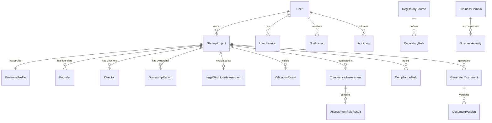

# VentureBlueprint: Database Architecture & Schema Specification
**Database Engine:** PostgreSQL 15+ (Production) / SQLite 3.38+ (Offline Local Development)  
**ORM Framework:** SQLAlchemy 2.0 (Declarative Base with Typed Mappings)  
**Naming Conventions:** Snake_case table and column names; explicit foreign key constraints with indexed relationships.

---

## 1. Entity-Relationship Overview

---

## 2. Table-by-Table Data Dictionary

### 2.1 Identity & Access Management Tables

#### `users`
Persists registered entrepreneur and administrative identities.
| Column | Type | Constraints | Description |
|---|---|---|---|
| `id` | VARCHAR(36) | PRIMARY KEY | Unique identifier (UUIDv4 format) |
| `email` | VARCHAR(255) | UNIQUE, NOT NULL, INDEX | Primary login credential & contact email |
| `hashed_password` | VARCHAR(255) | NOT NULL | Argon2id password hash |
| `full_name` | VARCHAR(255) | NOT NULL | User's legal name |
| `phone_number` | VARCHAR(32) | NULLABLE | Contact telephone |
| `is_active` | BOOLEAN | NOT NULL, DEFAULT true | Account status flag |
| `role` | VARCHAR(32) | NOT NULL, DEFAULT 'Founder' | RBAC role: `Admin`, `Founder`, `Professional` |
| `created_at` | DATETIME | NOT NULL, UTC | Registration timestamp |
| `updated_at` | DATETIME | NOT NULL, UTC | Last modification timestamp |

#### `user_sessions`
Tracks active user sessions and authentication tokens.
| Column | Type | Constraints | Description |
|---|---|---|---|
| `id` | VARCHAR(36) | PRIMARY KEY | Session identifier |
| `user_id` | VARCHAR(36) | FOREIGN KEY (`users.id`) | Associated user |
| `token_hash` | VARCHAR(128) | NOT NULL, INDEX | SHA-256 hash of active JWT |
| `ip_address` | VARCHAR(45) | NULLABLE | Remote client IP address |
| `user_agent` | VARCHAR(512) | NULLABLE | Client browser user agent |
| `expires_at` | DATETIME | NOT NULL | Session expiry timestamp |
| `created_at` | DATETIME | NOT NULL, UTC | Login timestamp |

---

### 2.2 Startup Project & Venture Entity Tables

#### `startup_projects`
The central root entity representing a company formation initiative.
| Column | Type | Constraints | Description |
|---|---|---|---|
| `id` | VARCHAR(36) | PRIMARY KEY | Project UUIDv4 |
| `owner_id` | VARCHAR(36) | FOREIGN KEY (`users.id`), INDEX | User who created the project |
| `name` | VARCHAR(255) | NOT NULL | Proposed company name |
| `domain` | VARCHAR(128) | NOT NULL | Business industry/domain |
| `preferred_structure`| VARCHAR(64) | NOT NULL | Preferred legal structure (e.g. Pvt Ltd, LLP) |
| `status` | VARCHAR(32) | DEFAULT 'Draft' | Lifecycle: `Draft`, `Validated`, `Incorporated`, `Archived` |
| `completion_percentage` | INTEGER | DEFAULT 0 | 0–100 progress indicator |
| `accent_color` | VARCHAR(32) | DEFAULT 'emerald' | UI visual theme tag |
| `created_at` | DATETIME | NOT NULL, UTC | Project creation date |
| `updated_at` | DATETIME | NOT NULL, UTC | Project last updated date |

#### `business_profiles`
Detailed operational, location, and financial parameters for the project.
| Column | Type | Constraints | Description |
|---|---|---|---|
| `id` | VARCHAR(36) | PRIMARY KEY | Profile UUID |
| `project_id` | VARCHAR(36) | FOREIGN KEY (`startup_projects.id`), UNIQUE | 1:1 relationship with project |
| `industry_category` | VARCHAR(128) | NULLABLE | Sub-industry classification |
| `detailed_activities`| TEXT | NULLABLE | Specific commercial operations |
| `business_model` | VARCHAR(128) | NULLABLE | B2B, B2C, Marketplace, D2C, SaaS |
| `target_audience` | TEXT | NULLABLE | Intended customers & demographic |
| `proposed_authorized_capital` | FLOAT | DEFAULT 100000.0 | Proposed authorized share capital (INR) |
| `proposed_paid_up_capital` | FLOAT | DEFAULT 100000.0 | Proposed paid-up capital (INR) |
| `has_investor_participation` | BOOLEAN | DEFAULT false | External institutional/angel backing flag |
| `funding_sources` | JSON | NULLABLE | Array of funding sources (Self, Angels, VC) |
| `expected_first_year_revenue`| VARCHAR(64) | NULLABLE | Revenue forecast tier |
| `registered_office_address` | TEXT | NULLABLE | Physical proposed office address |
| `state` | VARCHAR(64) | NULLABLE | Indian State / UT |
| `city` | VARCHAR(64) | NULLABLE | Operating city |
| `postal_code` | VARCHAR(12) | NULLABLE | 6-digit PIN code |
| `premise_type` | VARCHAR(64) | NULLABLE | Leased, Owned, Shared Workspace |
| `is_commercial_premise` | BOOLEAN | DEFAULT true | Commercial zoning flag |
| `expected_employee_count` | VARCHAR(32) | NULLABLE | Staff headcount bracket |
| `outsourced_services_needed`| JSON | NULLABLE | List of professional services required |

#### `founders`
Co-founders, subscribers, and promoters of the proposed venture.
| Column | Type | Constraints | Description |
|---|---|---|---|
| `id` | VARCHAR(36) | PRIMARY KEY | Founder UUID |
| `project_id` | VARCHAR(36) | FOREIGN KEY (`startup_projects.id`), INDEX | Project reference |
| `full_name` | VARCHAR(255) | NOT NULL | Legal name as per PAN |
| `email` | VARCHAR(255) | NOT NULL | Contact email |
| `phone_number` | VARCHAR(32) | NULLABLE | Contact phone |
| `residential_address` | TEXT | NULLABLE | Full permanent residential address |
| `pan_number` | VARCHAR(10) | NULLABLE | Indian Income Tax PAN |
| `din_number` | VARCHAR(8) | NULLABLE | Director Identification Number (if already held) |
| `proposed_shareholding_percentage`| FLOAT | DEFAULT 0.0 | Equity stake percentage (0-100%) |
| `proposed_shares_count` | INTEGER | DEFAULT 0 | Nominal share units allocated |
| `is_resident_of_india`| BOOLEAN | DEFAULT true | Sec 149(3) resident director qualification |
| `role_title` | VARCHAR(128) | DEFAULT 'Co-Founder' | Designation |

---

### 2.3 Regulatory & Compliance Evaluation Tables

#### `regulatory_sources`
Primary official legal authorities, ministries, and regulatory gazettes.
| Column | Type | Constraints | Description |
|---|---|---|---|
| `id` | VARCHAR(36) | PRIMARY KEY | Source UUID |
| `code` | VARCHAR(32) | UNIQUE, NOT NULL | Machine code (e.g., `MCA`, `CBIC_GST`, `MSME`, `DPIIT`) |
| `name` | VARCHAR(255) | NOT NULL | Ministry or Department name |
| `jurisdiction` | VARCHAR(64) | DEFAULT 'Republic of India'| Governing jurisdiction |
| `authority_name` | VARCHAR(255) | NOT NULL | Formal authority body |
| `website_url` | VARCHAR(512) | NOT NULL | Official portal URL |
| `description` | TEXT | NULLABLE | Regulatory mandate summary |

#### `regulatory_rules`
Codified statutory rules, compliance thresholds, and filing mandates.
| Column | Type | Constraints | Description |
|---|---|---|---|
| `id` | VARCHAR(36) | PRIMARY KEY | Rule UUID |
| `rule_code` | VARCHAR(32) | UNIQUE, NOT NULL, INDEX | e.g. `RULE-MCA-001`, `RULE-GST-001` |
| `source_id` | VARCHAR(36) | FOREIGN KEY (`regulatory_sources.id`) | Legal source reference |
| `title` | VARCHAR(255) | NOT NULL | Human-readable statutory title |
| `description` | TEXT | NOT NULL | Plain-language compliance requirement |
| `category` | VARCHAR(64) | NOT NULL | `corporate_law`, `taxation`, `labour`, `industry_specific` |
| `obligation_type` | VARCHAR(32) | NOT NULL | `mandatory`, `conditional`, `recommended` |
| `applicable_structure`| VARCHAR(64) | NULLABLE | Target entity structure (or ALL) |
| `applicable_domain`| VARCHAR(128) | NULLABLE | Target business domain (or ALL) |
| `legal_provision` | VARCHAR(255) | NOT NULL | Specific Act, Section, and Rule citations |
| `official_source_url`| VARCHAR(512) | NULLABLE | Link to gazette notification or MCA manual |
| `status` | VARCHAR(32) | DEFAULT 'Published' | `Draft`, `Under Review`, `Published`, `Deprecated` |

#### `compliance_tasks`
Interactive, actionable tasks synthesized from regulatory findings.
| Column | Type | Constraints | Description |
|---|---|---|---|
| `id` | VARCHAR(36) | PRIMARY KEY | Task UUID |
| `project_id` | VARCHAR(36) | FOREIGN KEY (`startup_projects.id`), INDEX | Project reference |
| `rule_code` | VARCHAR(32) | NULLABLE | Linked statutory rule code |
| `title` | VARCHAR(255) | NOT NULL | Actionable task name |
| `category` | VARCHAR(64) | NOT NULL | Category classification |
| `description` | TEXT | NOT NULL | Detailed action instructions |
| `obligation` | VARCHAR(32) | DEFAULT 'mandatory' | `mandatory`, `conditional`, `recommended` |
| `status` | VARCHAR(32) | DEFAULT 'Not Started'| `Not Started`, `In Progress`, `Completed`, `Blocked` |
| `due_date` | VARCHAR(32) | NULLABLE | Milestone or target deadline |
| `assigned_to` | VARCHAR(128) | NULLABLE | Designated founder or external CA |
| `notes` | TEXT | NULLABLE | Custom user progress notes |
| `official_url` | VARCHAR(512) | NULLABLE | Direct link to official filing portal |

---

### 2.4 Document Generation & Cryptographic Integrity Tables

#### `generated_documents`
Registry of professional PDF and DOCX documents created locally.
| Column | Type | Constraints | Description |
|---|---|---|---|
| `id` | VARCHAR(36) | PRIMARY KEY | Document UUID |
| `project_id` | VARCHAR(36) | FOREIGN KEY (`startup_projects.id`), INDEX | Project reference |
| `document_type` | VARCHAR(64) | NOT NULL | One of 8 supported report types |
| `file_format` | VARCHAR(16) | NOT NULL | `pdf` or `docx` |
| `file_path` | VARCHAR(512) | NOT NULL | Sandboxed filesystem path |
| `file_size_bytes` | INTEGER | NOT NULL | Exact byte length |
| `checksum_sha256` | VARCHAR(64) | NOT NULL | Cryptographic SHA-256 digest |
| `version` | INTEGER | DEFAULT 1 | Sequential version number |
| `metadata_json` | JSON | NULLABLE | Document parameters and generation timestamp |
| `created_at` | DATETIME | NOT NULL, UTC | Generation timestamp |

#### `document_versions`
Audit history of document revisions and prior generations.
| Column | Type | Constraints | Description |
|---|---|---|---|
| `id` | VARCHAR(36) | PRIMARY KEY | Version UUID |
| `document_id` | VARCHAR(36) | FOREIGN KEY (`generated_documents.id`), INDEX | Parent document |
| `version_number` | INTEGER | NOT NULL | Version iteration |
| `file_path` | VARCHAR(512) | NOT NULL | Historical file path |
| `file_size_bytes` | INTEGER | NOT NULL | Historical byte size |
| `checksum_sha256` | VARCHAR(64) | NOT NULL | Historical SHA-256 digest |
| `change_summary` | TEXT | NULLABLE | Reason for regeneration |

---

### 2.5 Audit Logging Table

#### `audit_logs`
Immutable audit ledger recording security-critical events.
| Column | Type | Constraints | Description |
|---|---|---|---|
| `id` | VARCHAR(36) | PRIMARY KEY | Log UUID |
| `user_id` | VARCHAR(36) | NULLABLE, INDEX | User actor (if authenticated) |
| `action` | VARCHAR(64) | NOT NULL | Event verb (e.g. `USER_REGISTER`, `DOCUMENT_GENERATE`) |
| `resource_type` | VARCHAR(64) | NOT NULL | Target entity type (`Project`, `Document`, `Rule`) |
| `resource_id` | VARCHAR(64) | NULLABLE | Target entity ID |
| `ip_address` | VARCHAR(45) | NULLABLE | Client IP address |
| `details` | JSON | NULLABLE | Structured context dictionary |
| `created_at` | DATETIME | NOT NULL, UTC | Event timestamp |
