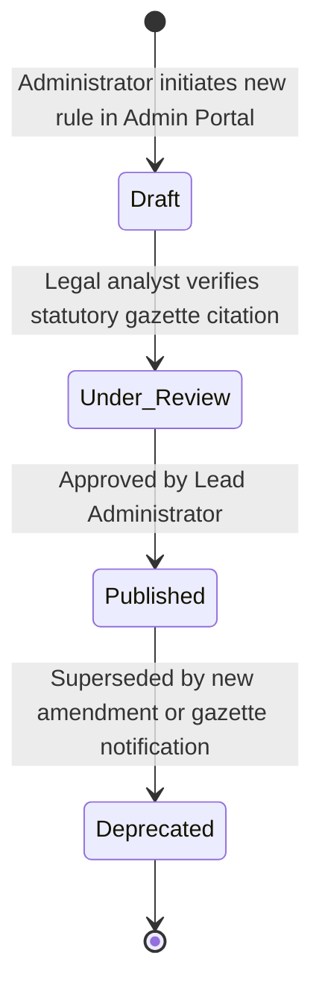

# VentureBlueprint: Indian Regulatory Framework & Data Curation Guide
**Governing Territory:** Republic of India  
**Applicable Legal Regimes:** Corporate Law (MCA), Direct & Indirect Taxation (CBDT/CBIC), Industry Incentives (DPIIT/MSME), Labour Statutes, and Data Governance (MeitY)  
**Maintenance Model:** 100% Deterministic Local Rule Tables & Admin Approval Workflow

---

## 1. Regulatory Authorities & Statutory Sources

| Regulatory Body | Short Code | Governing Statutes | Primary Portal |
|---|---|---|---|
| **Ministry of Corporate Affairs** | `MCA` | Companies Act, 2013; LLP Act, 2008; Companies (Incorporation) Rules, 2014 | [mca.gov.in](https://www.mca.gov.in) |
| **Central Board of Indirect Taxes & Customs** | `CBIC_GST` | Central Goods and Services Tax Act, 2017; IGST Act, 2017 | [gst.gov.in](https://www.gst.gov.in) |
| **Ministry of Micro, Small & Medium Enterprises** | `MSME` | Micro, Small and Medium Enterprises Development (MSMED) Act, 2006 | [udyamregistration.gov.in](https://udyamregistration.gov.in) |
| **Dept. for Promotion of Industry & Internal Trade** | `DPIIT` | National Startup Policy; Gazette Notification G.S.R. 127(E) | [startupindia.gov.in](https://www.startupindia.gov.in) |
| **Ministry of Electronics & IT** | `MeitY` | Digital Personal Data Protection Act, 2023 (Act No. 22 of 2023) | [meity.gov.in](https://www.meity.gov.in) |
| **Employees' Provident Fund Organisation** | `EPFO` | Employees' Provident Funds & Misc. Provisions Act, 1952 | [epfindia.gov.in](https://www.epfindia.gov.in) |
| **Employees' State Insurance Corporation** | `ESIC` | Employees' State Insurance Act, 1948 | [esic.gov.in](https://www.esic.gov.in) |

---

## 2. In-Depth Statutory Regimes

### 2.1 Corporate Incorporation & Name Reservation (MCA)

#### A. Name Availability Guidelines (Rule 8, Companies (Incorporation) Rules, 2014)
The MCA enforces rigorous guidelines under Section 4(2) of the Companies Act, 2013. A proposed name will be rejected if:
1. **Identical or Too Nearly Resembles:** Differs from an existing company only by punctuation, spacing, capitalization, phonetic spelling, pluralization, or generic geographic prefix/suffix.
2. **Prohibited Under Emblems & Names Act, 1950:** Terms including *National, Federal, Union, Prime Minister, President, Republic, Mahatma Gandhi, United Nations, WHO, State, Municipal*.
3. **Restricted Financial & Sectoral Keywords:** Rule 8B requires prior sectoral regulator clearance and statutory minimum capital for names containing:
   - *Bank, Banking, Savings*: Reserve Bank of India (RBI) approval required.
   - *Venture Capital, Mutual Fund, Stock Exchange, Asset Management*: Securities and Exchange Board of India (SEBI) approval required.
   - *Insurance, Reinsurance, Underwriting*: Insurance Regulatory and Development Authority (IRDAI) approval required.
4. **Mandatory Legal Structure Suffixes:**
   - Private Limited Company: `"Private Limited"` or `"Pvt Ltd"`
   - Limited Liability Partnership: `"LLP"` or `"Limited Liability Partnership"`
   - One Person Company: `"(OPC) Private Limited"`
   - Public Limited Company: `"Limited"` or `"Ltd"`

#### B. SPICe+ Integrated Incorporation
The MCA processes all company incorporations through the integrated **SPICe+** (INC-32) online portal:
- **Part A:** Name reservation (up to 2 proposed names per filing).
- **Part B:** Combined incorporation application covering:
  - Allotment of Director Identification Numbers (DIN) for up to 3 directors.
  - PAN and TAN issuance by Central Board of Direct Taxes.
  - EPFO and ESIC registrations.
  - Profession Tax registration (mandatory in Maharashtra, Karnataka, Gujarat, etc.).
  - Corporate bank account opening pre-selection.
  - Goods and Services Tax Identification Number (GSTIN) via AGILE-PRO-S (INC-35).

---

### 2.2 Indirect Taxation: Goods & Services Tax (GST)

#### A. Threshold-Based Registration (Section 22, CGST Act, 2017)
- **Suppliers of Goods:** Mandatory registration if aggregate annual turnover exceeds **₹40 Lakhs** (₹20 Lakhs for Special Category States: Arunachal Pradesh, Manipur, Meghalaya, Mizoram, Nagaland, Puducherry, Sikkim, Telangana, Tripura, Uttarakhand).
- **Suppliers of Services:** Mandatory registration if aggregate annual turnover exceeds **₹20 Lakhs** (₹10 Lakhs in Special Category States).

#### B. Compulsory Registration Without Threshold (Section 24, CGST Act, 2017)
Registration is legally required regardless of revenue threshold for:
1. Persons making any **inter-state taxable supply** of goods.
2. Casual taxable persons and non-resident taxable persons.
3. Persons supplying goods or services through an **e-commerce operator** required to collect tax at source (TCS under Section 52).
4. Persons liable to pay tax under **Reverse Charge Mechanism (RCM)**.
5. Every Electronic Commerce Operator.

---

### 2.3 MSME / Udyam Registration (MSMED Act, 2006)

Enterprises operating in manufacturing or service sectors qualify based on composite criteria (Investment in Plant & Machinery + Annual Turnover):
- **Micro Enterprise:** Investment ≤ ₹1 Crore AND Annual Turnover ≤ ₹5 Crore.
- **Small Enterprise:** Investment ≤ ₹10 Crore AND Annual Turnover ≤ ₹50 Crore.
- **Medium Enterprise:** Investment ≤ ₹50 Crore AND Annual Turnover ≤ ₹250 Crore.

#### Key Statutory Benefits:
- **Delayed Payment Protection:** Section 15 & 16 mandate buyer payments within 45 days; failure incurs compound interest at 3x the RBI bank rate.
- **Public Procurement Policy:** 25% mandatory annual procurement from MSEs by Central Ministries and Public Sector Undertakings.
- **Collateral-Free Credit:** Priority eligibility under Credit Guarantee Fund Trust for Micro and Small Enterprises (CGTMSE).
- **Subsidies:** 50% concession on trademark and patent government filing fees.

---

### 2.4 DPIIT Startup India Recognition

Administered by the Department for Promotion of Industry and Internal Trade under Notification G.S.R. 127(E):
- **Eligibility Criteria:**
  1. Incorporated as a Private Limited Company, Registered Partnership, or LLP.
  2. Entity age ≤ 10 years from the date of incorporation.
  3. Annual turnover has not exceeded **₹100 Crores** in any financial year since inception.
  4. Working towards innovation, development, or commercialization of new products, processes, or services driven by technology or intellectual property.
- **Statutory Benefits:**
  - **Section 80-IAC Tax Holiday:** 100% tax deduction on profits for 3 consecutive financial years out of the first 10 years (subject to Inter-Ministerial Board certification).
  - **Exemption from Section 56(2)(viib) ("Angel Tax"):** Exemption on share premium received from resident investors.
  - **Self-Certification:** Fast-track self-certification for 6 labour laws and 3 environmental laws for 3 to 5 years.
  - **Fast-Track IP:** Up to 80% rebate in patent application fees and expedited examination.

---

### 2.5 Data Protection: DPDP Act, 2023

Enacted as Act No. 22 of 2023, governing the processing of digital personal data within India:
- **Data Fiduciary Obligations:**
  - **Notice (Section 5):** Provide clear, itemized notice in plain language describing the personal data sought and specific purpose of processing.
  - **Consent (Section 6):** Consent must be free, specific, informed, unconditional, and unambiguous with clear affirmative action.
  - **Data Principal Rights:** Right to access summary of data, right to correction and erasure, right of grievance redressal, right to nominate representative.
  - **Child Data Safeguards (Section 9):** Verifiable parental consent required for minors (<18 years); strict prohibition on behavioral monitoring, targeted advertising, or tracking.
  - **Penalties:** Fines up to **₹250 Crores** for failure to take reasonable security safeguards to prevent personal data breaches.

---

## 3. Regulatory Rule Lifecycle & Curation Workflow

To ensure regulatory information remains accurate without requiring source code modifications, VentureBlueprint implements a database-driven Rule Approval Workflow:

### Curation Guidelines:
1. **Rule Code Standardization:** Must follow naming format: `RULE-[SOURCE]-[NUMBER]` (e.g., `RULE-MCA-005`, `RULE-GST-004`).
2. **Mandatory Legal Provision:** Every rule must cite the governing Act, Section number, and Rule/Sub-rule (e.g., *Section 149(3), Companies Act, 2013*).
3. **Official Gazette Verification:** Include official portal or Gazette PDF URL. Never link to commercial blogs or third-party law firm summaries.
4. **Actionable Formulation:** Plain-language descriptions must clearly delineate:
   - The statutory trigger condition (e.g., "When employee count reaches 20...").
   - The precise compliance filing (e.g., "Obtain EPFO registration via Shram Suvidha portal within 30 days").
