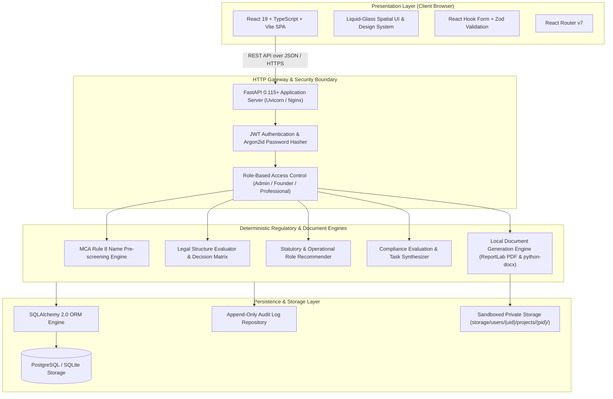

# VentureBlueprint: System Architecture & Design Specification
**Platform:** AI-Independent Company Formation, Regulatory Validation & Professional Documentation Platform  
**Primary Jurisdiction:** Republic of India (Companies Act 2013, LLP Act 2008, Partnership Act 1932, CGST Act 2017, MSME Act 2006, DPDP Act 2023)  
**Execution Environment:** 100% Local / Self-Contained / Zero Cloud AI Dependencies

---

## 1. Architectural Philosophy & Core Principles

VentureBlueprint is architected as an enterprise-grade, deterministic regulatory guidance and documentation engine. Unlike modern applications that rely on opaque, non-deterministic large language models (LLMs) with high hallucination risks, VentureBlueprint operates on **pure, verifiable, statutory business logic and local computational rules**.

### Core Tenets:
1. **Zero External AI / Deterministic Predictability:** No API calls to external cloud AI providers (OpenAI, Anthropic, Gemini, Ollama, etc.). Every recommendation, compliance flag, and document clause is derived from statutory rules codified in code and database schemas.
2. **Local Sovereignty & Data Privacy:** All company formation data, founder identifiers (PAN, Aadhaar, DIN), financials, and corporate blueprints remain strictly on the host system or inside an isolated container boundary.
3. **Auditability & Integrity:** Every regulatory check logs rule citations (Act, Section, Rule), timestamped execution records, and SHA-256 cryptographic checksums for generated PDF and DOCX files.
4. **Resilient Local Execution:** The entire system functions without live internet access after dependencies and initial regulatory datasets are installed.

---

## 2. High-Level Architecture Diagram

---

## 3. Subsystem Breakdown

### 3.1 Presentation Layer (Frontend)
- **Framework:** React 19 with TypeScript, bundled using Vite.
- **Styling Architecture:** Tailwind CSS v4 paired with a custom liquid-glass design system (`src/styles/glassmorphism.css`).
  - **Visual System:** Deep navy/charcoal background (`#0B0F19`), translucent layered glass panels (`backdrop-blur-md`, `bg-white/[0.03]`), borders (`rgba(255, 255, 255, 0.08)`), and emerald green accents (`#10B981`).
  - **Spatial Hierarchy:** Elevation tokens (Flat, Raised, Floating, Modal) with controlled depth, inner specular highlights, and soft ambient drop shadows.
- **Form Management & Client Validation:**
  - `react-hook-form` orchestrates multi-step wizard state across 7 comprehensive questionnaire sections.
  - `zod` schemas mirror backend validation constraints for instantaneous client-side feedback before submission.
- **State Management & Routing:**
  - `AuthContext` provides authenticated user context, token persistence, and active project state.
  - `ThemeContext` supports dark, light, and system-adaptive themes.
  - `react-router-dom` delivers client-side routing across 12 public pages and 8 authenticated portal views.

### 3.2 Application & API Layer (Backend)
- **Framework:** FastAPI running on Python 3.14 / Uvicorn ASGI server.
- **Data Validation & Serialization:** Pydantic v2 schemas (`app/schemas/all_schemas.py`) enforce type safety, regex format checks (PAN, PIN code, email, phone), and contract serialization.
- **Dependency Injection:** Centralized dependency resolution in `app/api/deps.py`:
  - `get_db`: Yields scoped SQLAlchemy database sessions.
  - `get_current_user`: Decodes and validates JWT bearer tokens, verifying active account status.
  - `get_user_project`: Enforces strict tenant isolation by ensuring the requesting user owns the target project (or possesses Admin privileges).
  - `require_admin`: Verifies administrative role before granting access to rule publishing and audit logs.

### 3.3 Deterministic Business Rules Engine (`app/rules_engine/`)

The rules engine is split into four specialized statutory modules:

#### A. MCA Rule 8 Name Pre-screening Engine (`name_prescreening.py`)
Implements strict checks under Rule 8 and 8A/8B of the Companies (Incorporation) Rules, 2014:
- **Prohibited Emblems & Names:** Identifies terms prohibited under the *Emblems and Names (Prevention of Improper Use) Act, 1950* (e.g., "National", "Imperial", "Governor", "Mahatma Gandhi", "Republic", "Union").
- **Financial Sector Keywords:** Flags restricted words requiring pre-approval or minimum paid-up capital from RBI, SEBI, or IRDAI (e.g., "Bank", "Banking", "Insurance", "Venture Capital", "Mutual Fund", "Asset Management").
- **Statutory Suffix Validation:** Validates required corporate endings:
  - Private Limited: `"Private Limited"`, `"Pvt Ltd"`
  - Limited Liability Partnership: `"LLP"`, `"Limited Liability Partnership"`
  - One Person Company: `"(OPC) Private Limited"`
  - Public Limited: `"Limited"`, `"Ltd"`
- **Structural Quality & Distinctiveness:** Evaluates prefix length, distinctiveness score, and provides actionable recommendations.

#### B. Legal Structure Decision Matrix (`structure_evaluator.py`)
Computes an empirical suitability score across all 5 primary Indian legal structures:
1. **Private Limited Company (Pvt Ltd):** Section 2(68) of Companies Act, 2013. Recommended for scalable ventures seeking institutional investment, requiring minimum 2 directors and 2 subscribers.
2. **Limited Liability Partnership (LLP):** LLP Act, 2008. Ideal for professional service firms and bootstrapped ventures requiring limited liability with minimal compliance overhead.
3. **One Person Company (OPC):** Section 2(62) of Companies Act, 2013. Recommended for solo entrepreneurs desiring corporate status with 100% equity retention.
4. **Partnership Firm:** Indian Partnership Act, 1932. Low setup cost for traditional businesses, accompanied by unlimited personal liability warnings.
5. **Sole Proprietorship:** Simplest form for solo retail/services, with zero corporate separation.

#### C. Role Recommendation Engine (`role_recommender.py`)
Maps organizational requirements into four distinct tiers:
1. **Statutory Roles:** Managing Director, Whole-time Director, Designated Partner, Resident Director (Sec 149(3)), Compliance Officer.
2. **Management Roles:** Chief Executive Officer (CEO), Chief Technology Officer (CTO), Head of Operations.
3. **Operational Roles:** Team leads, departmental managers, operational staff.
4. **External Professional Services:** Practicing Chartered Accountant (Statutory Auditor under Sec 139), Company Secretary (Secretarial compliance), Legal Counsel, Tax Advisor.

#### D. Regulatory Compliance Evaluator (`compliance_evaluator.py`)
Evaluates the venture against published statutory rules in the database:
- Analyzes thresholds: GST registration (Sec 22 CGST Act: ₹40L goods, ₹20L services), MSME/Udyam eligibility, DPDP Act 2023 consent architecture, Shop & Establishment Act, Professional Tax, EPF/ESIC employee thresholds.
- Generates structured compliance findings (`Passed`, `Warning`, `Failed`, `Needs Additional Information`) and synthesizes interactive `ComplianceTask` records with direct official portal URLs (MCA, GSTN, Udyam, Income Tax).

### 3.4 Local Document Generation Engine (`app/document_engine/`)

The platform generates complete, multi-page professional documentation locally:
- **PDF Engine (`pdf_generator.py`):** Uses ReportLab with custom platypus styles, running headers/footers with dynamic page numbering ("Page X of Y"), statutory warning banners, executive tables, and metadata callouts.
- **DOCX Engine (`docx_generator.py`):** Uses `python-docx` to construct editable Microsoft Word documents with corporate styling, heading hierarchies, bullet structures, and formal legal signature blocks.
- **Report Builders (`report_builders.py`):** Implements 8 complete document types:
  1. Complete Company Formation Blueprint
  2. MCA Compliance & Filing Strategy Report
  3. Pre-Incorporation Checklist & Evidence Guide
  4. Legal Structure Evaluation Report
  5. Founder & Governance Advisory Report
  6. Operational Setup & Infrastructure Plan
  7. Statutory Compliance Calendar
  8. Executive Formation Summary

---

## 4. Sandboxed Storage & Cryptographic Verification

All generated artifacts are managed by `app/storage/file_manager.py`:
- **Directory Isolation:** Files are written to a sandboxed local path:
  `storage/users/{user_id}/projects/{project_id}/{document_type}_{version}.{pdf|docx}`
- **Path Traversal Protection:** Every incoming file path is resolved and verified against the canonical base directory using `os.path.commonpath`.
- **Integrity Checksums:** Upon document generation, a SHA-256 cryptographic digest is calculated from the file stream and persisted in the `generated_documents` database table. Any post-generation tampering or corruption is instantly detectable.

---

## 5. Security & Isolation Architecture

1. **Password Security:** Credentials hashed using Argon2id (`argon2-cffi`), the state-of-the-art memory-hard password hashing algorithm winner of the Password Hashing Competition.
2. **Session & Token Management:** Stateless JSON Web Tokens (PyJWT) with HMAC-SHA256 signatures, configurable expiration (1440 minutes default), and secure Bearer authorization headers.
3. **Multi-Tenant Isolation:** All database queries for projects, questionnaires, documents, and tasks enforce user-level ownership checks (`StartupProject.owner_id == current_user.id`).
4. **Audit Logging:** Administrative and critical data changes generate immutable records in the `audit_logs` table, tracking `user_id`, `action`, `resource_type`, `resource_id`, `ip_address`, and contextual metadata.
5. **No Network Leakage:** The document generator and rules engine do not emit external telemetry, webhook calls, or data syncs.

---

## 6. Extensibility for International Jurisdictions

While India is the launch jurisdiction, the platform schema and rules engines are built to scale globally:
- `RegulatorySource` and `RegulatoryRule` models feature a `jurisdiction` attribute (defaulting to `"Republic of India"`).
- Additional jurisdiction plugins (e.g., United Kingdom Companies House, US Delaware C-Corp/LLC, Singapore ACRA) can be added by registering new statutory rules and country-specific evaluation modules without modifying the core presentation or orchestration layers.
